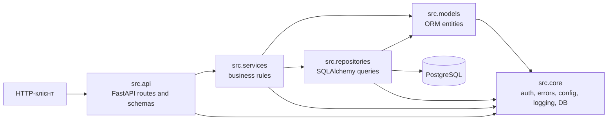

# Архітектура AutoBook SDD

## Призначення та межі

AutoBook SDD — HTTP API для каталогу послуг автосервісу, пошуку вільних
інтервалів, гаража клієнта, створення та скасування бронювань і знеособлення
акаунта. Поточна реалізація — FastAPI-застосунок із SQLAlchemy та PostgreSQL.
Цей опис відображає код і міграції, а не всі можливості, перелічені в SRS.

Основні вимоги, покриті наявними потоками: каталог — REQ-F-001; пошук слотів і
горизонт — REQ-F-002, REQ-F-004; гараж і прив'язка автомобіля до бронювання —
REQ-F-005, REQ-F-006; скасування — REQ-F-007; конкурентне створення —
REQ-NF-003, REQ-NF-004; знеособлення — REQ-NF-006. Причина скасування і її
редагування під час знеособлення відповідають затвердженому ADD-001:
REQ-F-015–REQ-F-017.

## Компоненти

Основний напрям залежностей: **api → services → repositories → models**.
`src.core` надає спільні залежності для цих рівнів. Деякі HTTP-обробники
каталогу й автомобілів створюють репозиторій і передають його сервісу
безпосередньо; цей адаптерний зв'язок не додає бізнес-правил до роутера.

### `src.api` — HTTP-рівень

`src.api.router` реєструє операції каталогу, гаража, слотів, бронювань і
знеособлення. Роутери перевіряють вхідні схеми, викликають сервіси та
перетворюють доменні відмови на HTTP-відповіді. Контрактні шляхи визначені в
`spec/api/openapi.yaml`.

### `src.services` — бізнес-логіка

- `catalog_service` повертає активний каталог (REQ-F-001).
- `slot_engine` шукає безперервний інтервал для вибраних послуг та перевіряє
  обмеження пошуку (REQ-F-002, REQ-F-004).
- `booking_service` створює бронювання та виконує клієнтське скасування
  (REQ-F-002, REQ-F-006, REQ-F-007, REQ-NF-003, REQ-NF-004,
  REQ-F-015, REQ-F-016).
- `vehicle_service` обслуговує гараж клієнта (REQ-F-005).
- `user_service` виконує знеособлення клієнта (REQ-NF-006, REQ-F-017).
- `audit_service` є заглушкою: його `record_status_change` наразі не записує
  нічого. Записи аудиту для реалізованих операцій створюються іншими потоками.

### `src.repositories` — доступ до даних

Репозиторії інкапсулюють читання та зміну ORM-рядків. `booking_repository`
перевіряє власника автомобіля/бронювання, конфлікти інтервалів і зберігає
бронювання разом із сервісами та записом аудиту. `schedule_repository` читає
зміни й активні бронювання та блокує рядки змін. Репозиторії користувачів,
автомобілів, послуг і аудиту реалізують відповідні запити.

### `src.models` — ORM-модель

`src.models.entities` визначає таблиці SQLAlchemy, первинні й зовнішні ключі,
обмеження тривалості послуг і частковий унікальний індекс бронювань.

### `src.core` — спільні механізми

- `auth` перевіряє Bearer JWT та витягує ідентифікатор і роль.
- `database` будує кешований SQLAlchemy engine та надає сесію запиту.
- `errors` формує помилки у форматі `application/problem+json`.
- `logging` налаштовує JSON-логування, ідентифікатор запиту та маскування
  відомих чутливих полів.
- `config` і `clock` надають конфігурацію та поточний час.

## Дані та ключі

Фактична схема визначена ORM-моделями та міграціями. У таблицях використано
UUID для ідентифікаторів; `booking_services` має складений первинний ключ.
Зовнішні ключі перелічені нижче; каскадне видалення кодом не задається.

| Таблиця | Ключі та основні поля |
|---|---|
| `users` | PK `id`; унікальний `email`; `password_hash`, `full_name`, nullable `phone`, `role`, `status`. |
| `vehicles` | PK `id`; FK `user_id` → `users.id`; `make`, `model`, `year`, `license_plate`, nullable `vin`. |
| `services` | PK `id`; `title`, `duration_min`, `price`, `is_active`; тривалість кратна 30 хвилинам і не менша за 30. |
| `masters` | PK `id`; nullable FK `user_id` → `users.id`; `full_name`. |
| `schedule_shifts` | PK `id`; FK `master_id` → `masters.id`; дата, початок/кінець зміни та nullable межі перерви. |
| `bookings` | PK `id`; унікальний `booking_number`; FK `client_id` → `users.id`, `vehicle_id` → `vehicles.id`, `master_id` → `masters.id`; статус і часовий інтервал; nullable `cancel_reason` (до 255 символів). |
| `booking_services` | Складений PK і FK (`booking_id`, `service_id`) → `bookings.id`, `services.id`; `price_at_booking`. |
| `audit_logs` | PK `id`; FK `actor_id` → `users.id`; дія, тип та ID сутності, nullable `old_val` і `new_val` (текстові поля із JSON-представленням у реалізованих записах). |

Індекс `idx_no_double_booking` — унікальний частковий індекс на
`bookings (master_id, start_time)` лише для статусів `PENDING`, `CONFIRMED` і
`IN_PROGRESS` (REQ-NF-004). Він захищає від однакового часу початку для
майстра; перевірку перетину інтервалів також виконує сервіс у транзакційному
потоці створення. Міграція `0002` дозволяє `users.phone` бути `NULL`, а
`0003` додає `bookings.cancel_reason`.

## Основні потоки

### Створення бронювання

1. API вимагає Bearer JWT і передає ідентифікатор користувача в
   `BookingService.create_booking`.
2. Сервіс відкриває одну транзакцію; перевіряє, що автомобіль належить
   користувачу; блокує рядки змін майстра на вибрану дату через
   `SELECT ... FOR UPDATE` (REQ-NF-003).
3. У тій самій транзакції сервіс перевіряє активні послуги, розраховує слот,
   перевіряє доступність і перетин з активним бронюванням.
4. Створюються бронювання зі статусом `PENDING`, знімки послуг/цін та початковий
   запис `AuditLog`; транзакція завершується спільно.
5. Порушення `idx_no_double_booking` перетворюється на конфлікт слоту й HTTP
   `409`. Виявлений раніше конфлікт активного інтервалу також повертає `409`.

Вимоги: REQ-F-002, REQ-F-006, REQ-NF-003, REQ-NF-004.

### Скасування бронювання

Текст причини довжиною понад 255 символів відхиляється до пошуку бронювання;
порожнє значення та лише пробіли трактуються як відсутня причина. В одній
транзакції сервіс шукає бронювання, яке належить клієнту, дозволяє скасування
лише у статусі `CONFIRMED` і не пізніше ніж за дві години до початку. Потім він
записує статус `CANCELLED_BY_CLIENT`, необов'язкову причину та audit-запис.
Причина не записується в прикладні логи. Неавторизоване для цього клієнта або
відсутнє бронювання повертає `404`, недозволений статус чи пізнє скасування —
`400`.

Вимоги: REQ-F-007, REQ-F-015, REQ-F-016.

### Анонімізація

Операцію може викликати лише автентифікований користувач із роллю `CLIENT`.
Сервіс блокує рядок користувача та в одній транзакції замінює ім'я й email,
очищає телефон, блокує акаунт, знеособлює номер/VIN автомобілів, обнуляє
`Booking.cancel_reason` і замінює `AuditLog.new_val.reason` на `[REDACTED]`.
Записи бронювань та аудиту зберігаються.

Вимоги: REQ-NF-006, REQ-F-017 (ADD-001).

## Помилки, логування та безпека

### Помилки

Обробники повертають структуру RFC 7807 з типом
`application/problem+json`. Помилки валідації, прикладні проблеми й HTTP-помилки
відображаються у відповідні поля; неочікувана помилка повертає загальну
відповідь `500` без внутрішніх деталей. Для створення бронювання конфлікт слоту
має статус `409`; правила скасування використовують `400` або `404`.

### Логування

`structlog` формує JSON-записи у stdout та у файл, заданий `APP_LOG_PATH`
(типово `logs/app.log`). HTTP middleware записує початок/завершення запиту,
`request_id` і `req_id`, код відповіді та тривалість. Потоки бронювання
записують бізнес-події та помилки БД. Логер маскує значення для відомих
чутливих імен полів; потік скасування пише лише факт наявності й довжину
причини, не сам текст. Цей опис посилається на наявну реалізацію, не є заявою
про повне покриття всіх подій, перелічених у вимогах.

### Безпека

Захищені маршрути використовують HTTP Bearer. `require_user` перевіряє JWT
алгоритму HS256, обов'язкові claims `sub`, `role`, `exp` та конфігурацію
`JWT_SECRET`; підтримувані значення ролей — `CLIENT`, `MASTER`, `ADMIN`.
Загального механізму перевірки дозволів за роллю немає: явна перевірка ролі
клієнта є, зокрема, в операції знеособлення. Каталог послуг доступний без
автентифікації. Видача токенів у застосунку не реалізована. Вимоги безпеки й
доступу мають зв'язок із REQ-NF-005, REQ-NF-006 та SRS RBAC; повна реалізація
всіх правил RBAC не заявляється.

## Реалізація вимог та відомі обмеження

Наведені в SRS можливості нижче не слід вважати реалізованими лише тому, що
вони описані в специфікації:

- **Не реалізовано / поза обсягом:** користувацький UI, видача токенів,
  адмін-API та Email-сповіщення.
- **REQ-F-008–REQ-F-013 — не реалізовано:** адміністративне редагування
  бронювання й overdue-відображення (REQ-F-008–REQ-F-009), керування графіками
  (REQ-F-010), форс-мажорне скасування з Email (REQ-F-011), Email-тригери й
  нагадування (REQ-F-012), аналітичний Dashboard (REQ-F-013).
- **REQ-F-014 — не реалізовано повністю:** загальна фіксація змін стану,
  графіків і редагувань відсутня; окремі записи аудиту створюються лише в
  наявних потоках створення/скасування бронювання.
- **REQ-NF-005 — не реалізовано:** код не реалізує реєстрацію, автентифікацію
  за паролем чи bcrypt-хешування паролів.
- **REQ-NF-007 — не реалізовано:** SLA 99.5% не забезпечується та не
  вимірюється кодом.
- **REQ-NF-008 — не реалізовано:** адаптивного вебінтерфейсу в системі немає.

Реалізовані API-операції та обмеження контракту описані в
[`spec/api/openapi.yaml`](../spec/api/openapi.yaml). Вимоги й критерії
приймання визначені у затвердженій [SRS](../spec/srs.tex) та ADD-001
([`spec/addendum_002.md`](../spec/addendum_002.md)).
